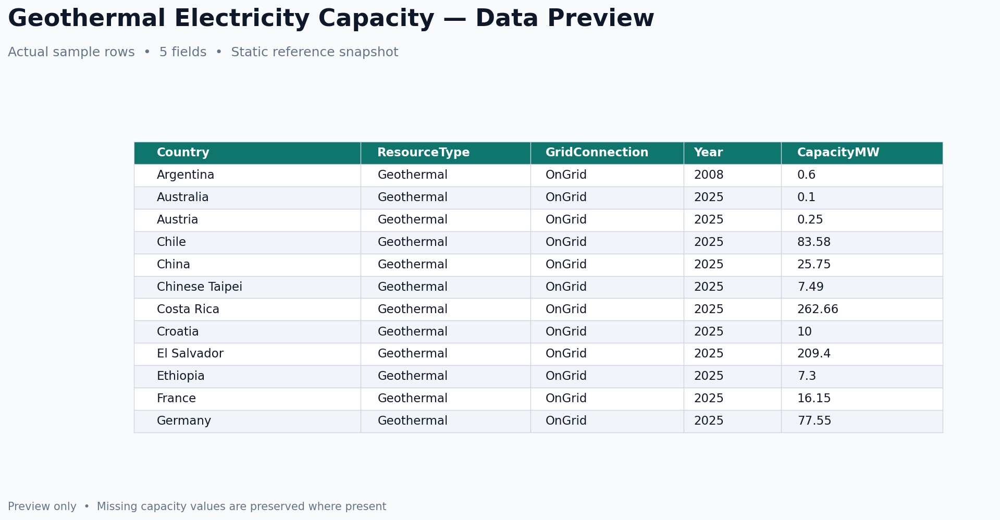
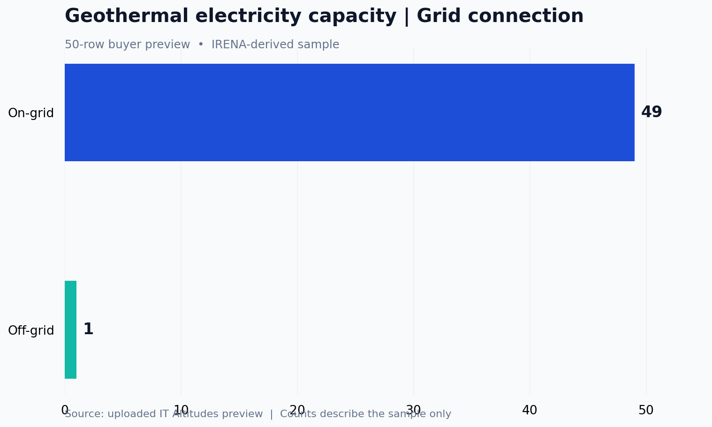

# Geothermal Energy Dataset | IT Altitudes Inc.

**11,648 Records | 224 Countries & Areas | 2000–2025**

Explore global geothermal electricity capacity data in a structured, research-friendly dataset, supported by source documentation, quality assessments, and buyer guidance.

**Preview Formats: Excel (.xlsx) | CSV (.csv) | JSON (.json)**

**Dataset Status: Commercial distribution subject to confirmation of applicable IRENA/IRENASTAT permissions.**

[View Dataset Information on Gumroad](https://italtitudes.gumroad.com/l/cncut)

---

## Why Choose This Dataset?

- **Save Preparation Time:** Work with standardized data instead of organizing raw statistical tables yourself.
- **Global Coverage:** Explore 11,648 country-level records across 224 countries and areas.
- **26 Years of Historical Coverage:** Review geothermal electricity capacity data from 2000 through 2025.
- **Flexible Data Formats:** Explore the preview structure using Excel, CSV, or JSON, subject to applicable source permissions.
- **Research-Friendly:** Suitable for Excel, Python, R, Power BI, and other analytical environments.
- **Quality Documentation:** Includes source mapping, methodology, data dictionary, and quality assessments.
- **Transparent Data:** Capacity values are included where reported; unavailable measurements remain blank.

## Who Is This Dataset Ideal For?

| Audience | Potential Benefits |
|---|---|
| Researchers & Academics | Geothermal energy studies, historical analysis, and academic research |
| Renewable Energy Companies | Country comparisons and preliminary market research |
| Government & Policy Analysts | Renewable energy planning and historical reporting |
| Consultants & Data Analysts | Benchmarking, visualization, and analytical reporting |
| Investors & Developers | Initial geographic screening and market research |
| Students & Educators | Renewable energy projects, teaching, and data analysis exercises |

## Business Use Cases

The **Geothermal Energy Dataset** supports historical research and analytical applications across renewable energy, electricity infrastructure, sustainability research, energy policy, and data engineering.

Its country-level observations from 2000–2025 can help researchers explore reported geothermal electricity capacity, identify historical patterns, and develop analytical models.

The following applications are illustrative and depend on the available fields, completeness, and permitted uses of the underlying source information.

### 1. Global Geothermal Energy Market Research

**Ideal for:** Renewable energy analysts, market research firms, and energy consultants.

**Business Applications:**

- Examine reported geothermal electricity capacity across countries and areas.
- Compare historical capacity observations between selected markets.
- Identify countries with reported geothermal electricity capacity.
- Prepare descriptive geothermal energy market research reports.
- Explore geographic differences in historical geothermal development.

**Potential Buyer Value:** Reduce manual preparation of country-level geothermal reference information and support structured renewable energy market research.

### 2. Renewable Energy Capacity Trend Analysis

**Ideal for:** Energy researchers, sustainability analysts, and academic institutions.

**Business Applications:**

- Analyze reported geothermal electricity capacity from 2000 through 2025.
- Study year-over-year changes where comparable observations are available.
- Compare historical geothermal capacity trends across selected countries.
- Create time-series charts and research summaries.
- Explore long-term changes in reported geothermal electricity infrastructure.

**Potential Buyer Value:** Support historical renewable energy trend analysis using organized country-year reference records.

**Important:** Missing measurements should not automatically be interpreted as zero installed capacity.

### 3. Energy Policy & Sustainability Research

**Ideal for:** Government policy researchers, energy economists, and sustainability consultants.

**Business Applications:**

- Examine historical geothermal electricity capacity across jurisdictions.
- Support descriptive renewable energy policy research.
- Compare available country-level geothermal capacity observations.
- Develop educational reports on renewable electricity infrastructure.
- Explore historical geothermal development alongside separately sourced policy information.

**Potential Buyer Value:** Provide structured reference information for renewable energy policy research and sustainability analysis.

**Important:** The dataset does not independently establish the effectiveness of any particular government policy.

### 4. Renewable Energy Investment & Market Screening Research

**Ideal for:** Renewable energy investment researchers, infrastructure consultants, and project development analysts.

**Business Applications:**

- Identify countries with historical geothermal electricity capacity observations.
- Compare reported capacity levels across selected geographic markets.
- Prepare preliminary renewable energy market screening reports.
- Support exploratory research into geothermal electricity development.
- Identify potential markets requiring additional technical and commercial investigation.

**Potential Buyer Value:** Help organize historical geothermal capacity information for early-stage market research.

**Important:** Historical installed capacity alone does not establish project feasibility, resource potential, profitability, investment suitability, or current market opportunity.

### 5. Energy Business Intelligence & Data Visualization

**Ideal for:** Business intelligence teams, energy data analysts, and dashboard developers.

**Business Applications:**

- Create historical geothermal capacity dashboards.
- Visualize reported capacity by country and year.
- Prepare comparative country-level charts.
- Develop analytical reports using Excel, Python, R, or Power BI.
- Explore available data by resource type and grid connection classification.

**Potential Buyer Value:** Simplify preparation of geothermal reference data for exploratory dashboards and research visualizations.

### 6. Renewable Energy Data Engineering & ETL Development

**Ideal for:** Data engineers, database developers, and analytics teams.

**Business Applications:**

- Test ingestion of structured energy reference records.
- Practice cleaning and transforming country-year datasets.
- Develop missing-value handling and data validation workflows.
- Prototype historical time-series data processing.
- Build non-production analytical pipelines using permitted reference data.
- Evaluate schema consistency across available data fields.

**Potential Buyer Value:** Support development and testing of analytical data workflows involving historical energy statistics.

### 7. Academic Research & Renewable Energy Education

**Ideal for:** Universities, research institutions, students, and educators.

**Business Applications:**

- Study historical geothermal electricity capacity patterns.
- Compare available country-level observations.
- Practice statistical analysis and time-series visualization.
- Develop educational exercises involving renewable energy data.
- Support academic research into global renewable electricity development.

**Potential Buyer Value:** Provide a structured framework for educational analysis of historical geothermal capacity information.

## Dataset Preview & Visual Insights

### Sample Data Preview

### Grid Connection Distribution

Explore the free 50-row sample to understand country-level geothermal electricity capacity records, grid connection categories, historical years, and reported capacity values.

**Note:** Visualizations represent the curated preview sample, not the distribution of the complete dataset.

For dataset documentation, source information, and quality limitations, see [Data Quality Report](DATA_QUALITY_REPORT.md).

### Why Consider the Complete Dataset?

The prepared dataset is designed to offer:

- **11,648 reference records** across 224 countries and areas.
- **Historical coverage from 2000 through 2025.**
- **Structured data fields** for country, resource type, grid connection, year, and capacity.
- **Supporting documentation** describing methodology, provenance, and limitations.
- **Quality assessments** covering internal preparation and data review.
- **Analytical compatibility** with common spreadsheet and programming tools.

**[View Geothermal Dataset Information](https://italtitudes.gumroad.com/l/cncut)**

*Commercial distribution, including the full dataset and any source-derived preview files, remains subject to applicable IRENA/IRENASTAT permissions.*

*These use cases are illustrative. The dataset is a static historical reference and is not a live electricity generation, forecasting, investment, or operational monitoring service.*

---

## What Is Included in the Full Buyer Kit?

- Complete geothermal electricity capacity dataset
- Data Dictionary
- Source-to-Final Mapping
- Methodology and Preparation Notes
- Source Provenance
- Quality Summary and Validation Documentation
- Buyer Use Cases
- Limitations and Data Availability Notes
- License and Usage Terms
- Product Summary

## Free 50-Row Buyer Preview — Excel, CSV & JSON

A prepared 50-record preview is intended to help users evaluate the dataset's structure, fields, and suitability for research or analytical workflows.

**Distribution of source-derived preview files requires confirmation of applicable permissions.**

### Preview File References

| Format | Best For | File Reference |
|---|---|---|
| Excel (.xlsx) | Spreadsheet exploration and review of supporting documentation | [View Repository](https://github.com/ITAltitudesDataset/geothermal-electricity-capacity-dataset) |
| CSV (.csv) | Python, R, SQL, Power BI, and data processing | [CSV Preview File](https://github.com/ITAltitudesDataset/geothermal-electricity-capacity-dataset/raw/refs/heads/main/Geothermal_50_Row_Buyer_Preview.csv) |
| JSON (.json) | Application development, structured data workflows, and integration testing | [JSON Preview File](https://github.com/ITAltitudesDataset/geothermal-electricity-capacity-dataset/raw/refs/heads/main/Geothermal_50_Row_Buyer_Preview.json) |

**Preview Details**

- **Sample Size:** 50 records
- **Data Columns:** 5
- **Coverage:** Selected country-level geothermal electricity capacity observations
- **Fields:** Country, ResourceType, GridConnection, Year, CapacityMW
- **Formats:** Excel, CSV, and JSON

The CSV and JSON previews are derived from the same 50-row Excel sample worksheet.

The sample is curated and is not representative of the complete dataset's missing-value distribution.

*These file references should only be made publicly downloadable after the applicable redistribution rights have been confirmed.*

## IT Altitudes Quality & Value Documentation

This repository includes IT Altitudes' internally prepared assessment certificates covering:

- Content Validation
- Product Value and Quality Assessment
- Data Preparation Effort and Quality
- Buyer Benefits and Target Audiences

These certificates describe internal preparation, assessment, and intended uses. They are not independent third-party certifications.

## IT Altitudes — Dataset Certificates

These certificates document IT Altitudes Inc.'s internal assessments and are not independent third-party certifications.

### 1. Content Validation Certificate

### 2. Product Value Certificate

### 3. Data Preparation & Quality Certificate

### 4. Buyer Benefits Certificate

### View the Full Dataset

[View Dataset Information on Gumroad](https://italtitudes.gumroad.com/l/cncut)

## Source Attribution & Disclaimer

This Geothermal Energy Dataset has been independently cleaned, validated, and documented by IT Altitudes Inc., using publicly accessible data from IRENA/IRENASTAT.

IT Altitudes Inc. is not affiliated with or endorsed by IRENA, and all original source rights remain with their respective owners.

**Important:** Commercial redistribution remains subject to applicable IRENA/IRENASTAT source permissions. This disclaimer does not grant redistribution rights or replace any required authorization from IRENA.

This is a historical reference dataset. Some capacity measurements are unavailable in the original source and are retained as blanks.

## Get the Complete Dataset

**[View Geothermal Energy Dataset Information on Gumroad](https://italtitudes.gumroad.com/l/cncut)**

*Commercial availability is subject to confirmation of applicable source redistribution permissions.*

Prepared by **IT Altitudes Inc.**

For product inquiries: support@italtitudesdataset.zohodesk.in

---

## License, Source Rights & Disclaimer

- [Preview Documentation Usage Terms](LICENSE.md)
- [Source Attribution & Liability Disclaimer](DISCLAIMER.md)

**Important:** This dataset references IRENA/IRENASTAT information. Source-derived data is subject to applicable IRENA licensing and redistribution requirements. IT Altitudes' documentation usage terms do not grant commercial redistribution rights over IRENA data.

This dataset is a static research reference and should not be treated as live operational data.

## Explore More Datasets from IT Altitudes Inc.

Discover our other curated datasets, with free previews and documentation:

- [OFAC Sanctions (SDN) Dataset](https://github.com/ITAltitudesDataset/ofac-sanctions-dataset-sample)
- [US CRE Loan Maturity & Risk](https://github.com/ITAltitudesDataset/us-cre-loan-maturity-risk-dataset-preview)
- [US Area Codes & Geographic Reference](https://github.com/ITAltitudesDataset/us-area-codes-dataset-preview)
- [Global Tariff Realignment](https://github.com/ITAltitudesDataset/Global-Tariff-Realignment-Dataset-Preview)

**[Explore Our Complete Dataset Catalog](https://github.com/ITAltitudesDataset)**
