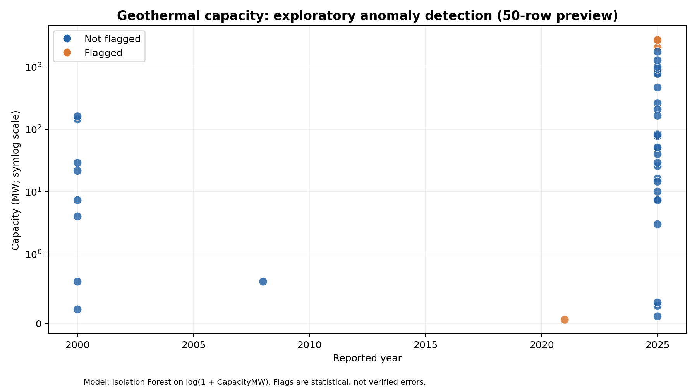

# Geothermal Electricity Capacity — ML Demonstration

**Prepared by IT Altitudes Inc.**

## What this demonstration does

This executable Python example fits an **Isolation Forest** to reported geothermal capacity values in the free 50-row preview. It flags observations that are unusual **relative to this selected sample**.

**This is a genuine fitted unsupervised model**, not a forecast, classification of actual errors, or a validated production model.

## Preview and approach

- Input: `Geothermal_50_Row_Buyer_Preview.csv` (50 records)
- Numeric `CapacityMW` values available: **40**
- Missing `CapacityMW` values: **10**, excluded from training rather than filled with zero
- Model: `sklearn.ensemble.IsolationForest` with `n_estimators=200`, `contamination=0.10`, `random_state=42`
- Feature: `log1p(CapacityMW)`; no year, country or grid-connection features are used
- Output: `geothermal_ml_results.csv` and `geothermal_ml_chart.png`



## Reproduce locally

Install Python packages:

```bash
pip install pandas numpy matplotlib scikit-learn
```

Run from this folder:

```bash
python geothermal_ml_demo.py
```

The script reads the bundled CSV and regenerates the results and chart. The flag count is partly determined by the model's preset 10% contamination parameter; it is **not an observed error rate**.

## Interpretation and limitations

The free preview intentionally prioritizes rows with reported capacity, so it is **not a representative sample** of the full dataset. Years and countries are mixed; high or low values may be completely legitimate. With only one numeric feature and 40 training rows, the model demonstrates a workflow, not reliable energy-sector anomaly detection. There are no ground-truth labels, so accuracy, precision and recall cannot be meaningfully reported. Never use flags as evidence that source records are incorrect.

**Original source:** IRENASTAT / International Renewable Energy Agency (IRENA). IT Altitudes Inc. is an independent curator, not endorsed by IRENA.

**Rights notice:** Commercial redistribution authorization for source-derived IRENA material has not been confirmed. This demonstration does not grant any rights to redistribute the underlying source dataset. Do not use this example as evidence of commercial licensing clearance.

For more context, see the repository's `DATA_QUALITY_REPORT.md`.
